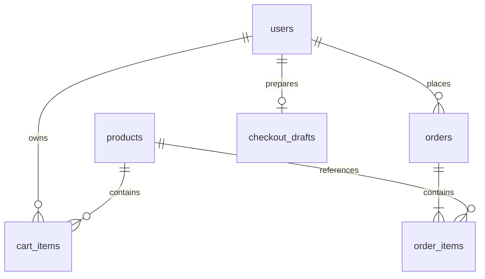

## 1. Кто покупатель и что он хочет получить?

Покупатель — человек, который хочет приобрести парфюмерию для себя или в подарок. Он хочет посмотреть доступные ароматы, узнать их характеристики и стоимость, выбрать подходящие товары и оформить заказ через бота.

## 2. Что выбирает покупатель и какие сведения нужны для заказа?

Покупатель выбирает один или несколько ароматов из каталога, указывает их количество и добавляет в корзину. Для оформления заказа необходимо указать имя и номер телефона. Перед подтверждением бот показывает выбранные товары и итоговую стоимость. Получение заказа — самовывоз, оплата при получении.

## 3. Что происходит после подтверждения заказа: кто его видит и как меняется статус?

После подтверждения бот сохраняет заказ, присваивает ему уникальный номер и устанавливает статус «Новый». Менеджер видит заказ и может менять его статус на «В обработке», «Готов к выдаче», «Выдан» или «Отменён». Покупатель может посмотреть текущий статус заказа через бота.

## 4. В какой момент заказ считается оформленным?

Заказ считается оформленным после того, как покупатель выбрал товары, указал контактные данные и нажал кнопку «Подтвердить заказ». Бот сохраняет заказ и показывает его номер, итоговую стоимость и статус «Новый».

---

# Scentory — учебный Telegram-магазин парфюмерии

Бот: **@ScentoryBot**, уже создан через BotFather. Покупатель выбирает ароматы
и оформляет самовывоз, менеджер обрабатывает заказы. Это учебный проект без
платёжной интеграции: расчёт только при получении.

**Уточнение требований:** четыре исходных ответа выше сохранены без изменений.
Упоминания телефона и контактных данных в ответах 2 и 4 относятся к первоначальной
формулировке. В действующем сценарии требуется только имя или псевдоним;
телефон и домашний адрес не запрашиваются. Для демонстрации используйте вымышленные
имена. Заказ считается оформленным только после успешного сохранения транзакции в БД.

## Текущее состояние: реализованы этапы 1–5

Реализованы безопасная загрузка настроек, запуск через long polling, `/start`,
главное меню, `/myid`, интерфейс менеджера `/admin` и обработка
неизвестных кнопок. Бот работает в личном чате.
Добавлены SQLite, регистрация пользователя по `/start`, каталог из шести ароматов,
карточки с названием, объёмом, описанием и ценой, возврат в каталог и главное меню.
Работает корзина: добавление, увеличение и уменьшение количества, удаление,
цена каждой позиции и общий итог. Корзины пользователей разделены и сохраняются
после перезапуска. Работает оформление: псевдоним, проверка заказа, подтверждение,
номер, список собственных заказов и детали. Менеджер видит новые и все заказы,
открывает детали и меняет статусы. Покупатель видит обновлённый статус, заново
открыв «Мои заказы» или детали. При запуске создаются шесть таблиц.

## Реализованные этапы

1. **Основа (завершена):** структура, конфигурация, запуск, приветствие и меню.
   Пользователь сообщил, что этап работает, и разрешил продолжение.
2. **База и каталог (реализованы):** схема SQLite, пользователи, шесть заданных вымышленных ароматов,
   идемпотентное наполнение по постоянному `seed_key`, список и карточки товаров.
3. **Корзина (реализована):** отдельная корзина покупателя, количество, удаление, итог в копейках;
   тесты расчёта, изменения и запрета некорректного количества.
4. **Оформление и мои заказы:** имя/псевдоним, проверка заказа, атомарное сохранение,
   ключ операции, защита от повторных и одновременных подтверждений, свои заказы;
   тесты транзакций, исторической цены, повторов, доступа и отката при ошибке.
5. **Менеджер и итоговая проверка:** новые заказы, детали, изменение статуса,
   проверки прав в обработчиках и слое БД, дополнительные тесты и документация.

Работа выполнялась поэтапно. Автоматические проверки описаны ниже; итоговый ручной
прогон в Telegram выполняет студент и заполняет фактические результаты.

## Пользовательский сценарий

```text
/start → Главное меню → Каталог → Карточка → Добавить в корзину
       → Корзина → Оформление → Имя/псевдоним → Проверка заказа
       → Подтвердить → Номер заказа → Мои заказы → Детали и статус
```

Перед подтверждением: имя, все позиции с количеством и ценой, итог,
самовывоз из учебного пункта Scentory, расчёт при получении; доступен возврат назад.
Менеджер: главное меню или `/admin` → новые заказы → детали → изменение статуса.

## Технологии и архитектура

Python **3.11+**, aiogram **3**, SQLite, aiosqlite, python-dotenv.
Прямые зависимости зафиксированы в `requirements.txt`. Для тестов используется
стандартный `unittest`; Telegram и настоящий токен для них не нужны.

`config.py` отвечает только за настройки, `keyboards.py` — за inline-кнопки,
`handlers/common.py` — за команды и ответы, `__main__.py` — за сборку и запуск.
Объект `Settings` передаётся обработчикам через контекст `Dispatcher`.
Импорт модулей не читает `.env` и не запускает соединение с Telegram.

На этапе 2 через тот же контекст передаётся `Repository` — объект для запросов к БД.
Обработчик каталога отвечает за сообщения, репозиторий — за SQL с параметрами,
`connection.py` — за соединения и инициализацию. Каждая операция получает отдельное
соединение: это подготовка к независимым транзакциям оформления. Специальный
обработчик каталога подключён перед общим обработчиком неизвестных кнопок.
Навигация отправляет новое сообщение, поэтому старые кнопки остаются доступны;
карточка при каждом нажатии заново читает текущую цену и доступность из БД.

Итоговая структура:

```text
scentory/
├── README.md
├── requirements.txt
├── .gitignore
├── .env.example
├── scentory/
│   ├── __init__.py
│   ├── __main__.py
│   ├── config.py
│   ├── keyboards.py
│   ├── formatting.py       # форматирование целых копеек
│   ├── handlers/
│   │   ├── __init__.py
│   │   ├── common.py
│   │   ├── catalog.py       # этап 2
│   │   ├── cart.py          # этап 3
│   │   ├── checkout.py      # этап 4
│   │   ├── orders.py        # этап 4
│   │   └── admin.py         # этап 5
│   ├── database/
│   │   ├── __init__.py
│   │   ├── connection.py    # этап 2: подключение и инициализация
│   │   ├── schema.sql       # этап 2
│   │   ├── seed.py          # этап 2
│   │   ├── repository.py    # общий интерфейс запросов, каталог и корзина
│   │   ├── orders.py        # этап 4: черновики и транзакция заказа
│   │   └── admin.py         # этап 5: проверка прав и изменение статусов
├── tests/
│   ├── test_stage1.py
│   ├── test_catalog.py      # этап 2: команды и кнопки с временной БД
│   ├── test_cart.py         # этап 3: операции, доступ, параллельные нажатия
│   ├── test_checkout.py     # этап 4: транзакции, повторы, доступ, сценарий
│   ├── test_admin.py        # этап 5: права, статусы, параллельные изменения
│   └── test_database.py     # этапы 2–5: временная SQLite
├── docs/
│   └── manual-testing.md
└── data/                   # локальная БД создаётся при запуске
```

## Схема базы данных

Схема реализована в `scentory/database/schema.sql`. На этапе 4 задействованы таблицы
заказов и добавлена таблица черновиков. Методы менеджера работают с теми же заказами.

Связи «один ко многим»:



Все поля обязательны (`NOT NULL`), кроме явно указанных необязательных.
ID, количества, объёмы и денежные значения имеют тип `INTEGER`, строки и даты — `TEXT`.
Деньги — целые копейки: 1890 ₽ = 189000 коп.; `float` для денег не используется.

| Таблица | Поля и ограничения |
| --- | --- |
| `users` | `id` PK; `telegram_id` UNIQUE, > 0; `platform` CHECK = 'telegram'; `display_name` (необязательный псевдоним); `created_at` UTC |
| `products` | `id` PK; `seed_key` UNIQUE; `name`; `description`; `volume_ml` > 0; `price_kopecks` > 0; `is_available` CHECK IN (0, 1) |
| `cart_items` | `user_id` FK → users; `product_id` FK → products; `quantity` > 0; составной PK (`user_id`, `product_id`) |
| `orders` | `id` INTEGER PRIMARY KEY AUTOINCREMENT (номер); `user_id` FK → users; `recipient_name` непустое; `total_kopecks` > 0; `delivery_method` CHECK = 'pickup'; `payment_method` CHECK = 'on_receipt'; `status` CHECK из списка ниже; `created_at` UTC; `checkout_key` UNIQUE |
| `order_items` | `id` PK; `order_id` FK → orders; `product_id` FK → products; `product_name` (снимок); `volume_ml` > 0 (снимок); `price_kopecks` > 0 (снимок); `quantity` > 0; UNIQUE (`order_id`, `product_id`) |
| `checkout_drafts` | `checkout_key` TEXT PK; `user_id` UNIQUE FK → users; `recipient_name` и `snapshot` (JSON показанных позиций) — оба NULL до ввода имени, затем оба заполнены |

Статусы: «Новый», «В обработке», «Готов к выдаче», «Выдан», «Отменён».
Статуса «Оплачено» нет. Товары с историей заказов отключаются, а не удаляются.
На каждом подключении включены `PRAGMA foreign_keys = ON` и ожидание блокировки
до 5 секунд через `busy_timeout`. Для денежных значений и количества схема проверяет
целочисленный тип (`typeof(...) = 'integer'`).

### Инициализация и сохранение данных

При запуске создаётся родительский каталог БД, затем в одной транзакции создаются
недостающие таблицы и добавляются начальные товары. `seed_key` уникален:
`ON CONFLICT(seed_key) DO NOTHING` сохраняет уже существующие строки, включая
изменённую цену и доступность. Повторный запуск не возвращает отключённый товар
в каталог. Это наполнение, а не механизм миграции: будущие изменения структуры
существующих таблиц потребуют отдельной миграции, а не удаления рабочей БД.

`/start` идемпотентно регистрирует Telegram ID. Имена и username из Telegram
не копируются; поле `display_name` пока остаётся пустым. Файл SQLite переживает
перезапуск приложения. Не удаляйте его, если хотите сохранить данные.

| Аромат | Объём | Цена |
| --- | --- | --- |
| Цитрусовое утро | 30 мл | 1890 ₽ |
| Цветочный сад | 30 мл | 2190 ₽ |
| Ванильный вечер | 30 мл | 2290 ₽ |
| Морской бриз | 50 мл | 2590 ₽ |
| Тёмный лес | 50 мл | 2790 ₽ |
| Пряная ночь | 50 мл | 2990 ₽ |

### Оформление — этап 4

Сохранение заказа: `BEGIN IMMEDIATE` → поиск заказа по уникальному ключу операции
с проверкой владельца → чтение актуальной корзины и доступности товаров → расчёт
суммы в приложении → заказ → снимки позиций → очистка корзины → `COMMIT`.
При ошибке — `ROLLBACK`. Ключ генерируется до показа подтверждения и включается
в кнопку. Повторный запрос возвращает тот же заказ; блокировка записи и UNIQUE
защищают также от почти одновременных нажатий. При изменении корзины после показа
итога потребуется повторная проверка заказа покупателем.

Слой БД принимает Telegram ID действующего пользователя: свои заказы читает
запрос с ограничением владельца, менеджерские методы отдельно проверяют `ADMIN_IDS`.
Цена никогда не берётся из callback_data или текста сообщения.

## Установка и запуск

Нужен установленный Python 3.11 или новее и доступ к Telegram через интернет.
Команды выполняются из каталога проекта. `.env` создайте только у себя;
не отправляйте его содержимое в чат, репозиторий или скриншоты.

### Windows PowerShell

```powershell
cd C:\Users\vonik\Desktop\scentory
py -3 --version
py -3 -m venv .venv
.\.venv\Scripts\python.exe -m pip install -r requirements.txt
if (-not (Test-Path -LiteralPath .env)) { Copy-Item -LiteralPath .env.example -Destination .env }
notepad .env
```

В редакторе локально заполните `BOT_TOKEN` токеном уже созданного бота, сохраните файл.
`ADMIN_IDS` пока оставьте пустым. Затем:

```powershell
.\.venv\Scripts\python.exe -m scentory
```

Активация окружения необязательна: явный путь к Python работает без изменения
политики выполнения PowerShell. Если хотите активировать: `.\.venv\Scripts\Activate.ps1`.

### macOS / Linux

```bash
cd /path/to/scentory
python3 --version
python3 -m venv .venv
.venv/bin/python -m pip install -r requirements.txt
if [ ! -e .env ]; then cp .env.example .env; fi
nano .env
```

Заполните `BOT_TOKEN` локально, сохраните файл, затем:

```bash
.venv/bin/python -m scentory
```

При отсутствии модуля venv в Linux установите пакет `python3-venv` средствами своей ОС.
Необязательная активация: `source .venv/bin/activate`.

Остановка на обеих платформах: **Ctrl+C**. Одновременно запускайте только один
процесс с этим токеном. Для бота, ранее работавшего через webhook, сначала требуется
его отключение; приложение не сбрасывает webhook автоматически.

### Настройки и менеджер

| Переменная | Значение |
| --- | --- |
| `BOT_TOKEN` | Обязательный секрет, заполняется только в локальном `.env` |
| `ADMIN_IDS` | Числовые Telegram ID через запятую; пусто — менеджеров нет |
| `DATABASE_PATH` | По умолчанию `data/scentory.sqlite3`; файл создаётся автоматически, относительный путь отсчитывается от корня проекта |

1. Отправьте `/myid` боту в личном чате.
2. Скопируйте полученный числовой ID в `ADMIN_IDS` в своём `.env`.
3. Перезапустите приложение и отправьте `/start`.
4. Появится «Управление заказами»; эта кнопка и `/admin` открывают новые заказы.
5. Откройте заказ, выберите статус и проверьте результат в его карточке.
   Для заказов, ушедших из списка новых, используйте «Все заказы».

Менеджер никогда не определяется по username или слову «админ».
Настройки читаются из `.env` в корне проекта; уже существующие переменные окружения
имеют приоритет. После изменения настроек нужен перезапуск.
Токен исключён из строкового представления настроек; ошибки не печатают значения
настроек, содержимое событий и сетевые URL. Проверка формата токена не доказывает
его действительность: это проверяет Telegram при запуске.

## Автоматические и ручные проверки

Windows:

```powershell
.\.venv\Scripts\python.exe -m unittest discover -s tests -v
.\.venv\Scripts\python.exe -m compileall -q scentory tests
.\.venv\Scripts\python.exe -m pip check
```

macOS / Linux:

```bash
.venv/bin/python -m unittest discover -s tests -v
.venv/bin/python -m compileall -q scentory tests
.venv/bin/python -m pip check
```

Тесты этапа 1 читают только временный файл настроек и подменённое окружение;
настоящий `.env` не используется. Вызовы Telegram заменены `AsyncMock`.
Проверяются конфигурация, маршрутизация `/start`, `/myid`, доступ менеджера,
подмена callback, уведомления будущих разделов и устаревшие кнопки.
Тесты корзины и заказов используют временную SQLite-базу.

Тесты этапа 2 уже используют отдельную временную SQLite-базу на каждый тест:
проверяют шесть товаров, сохранность ID и изменений при повторной инициализации,
одновременную инициализацию, регистрацию пользователей без дубликатов, ограничения
схемы и внешние ключи, пустой каталог, недоступные товары, подменённые кнопки,
переходы между карточкой и меню и понятные ответы при ошибках БД.

Шаблон ручных проверок: [docs/manual-testing.md](docs/manual-testing.md).
Фактические результаты заполняет студент после проверки в Telegram.

Фактически выполнено помощником 09.10.2026 на Windows / Python 3.13.2:
установлены зависимости; `unittest` — 12 тестов, OK; `compileall` — без ошибок;
`pip check` — конфликтов зависимостей нет. Первоначальный запуск тестов в
ограниченной среде завершился ошибками доступа к Temp; повторный запуск с
разрешением прошёл успешно. Настоящий `.env` не читался, соединение с настоящим
ботом не проверялось. Запуск на Python 3.11 и macOS/Linux пока не проверен.

Этап 2, фактически выполнено помощником 09.10.2026 на Windows / Python 3.13.2:
`unittest` — **27 тестов, OK** (включая проверки первого этапа), `compileall` —
без ошибок, `pip check` — конфликтов нет. Тесты запущены с разрешением доступа
к временным каталогам Windows. Настоящий `.env` и рабочая база не читались;
подключение к настоящему Telegram-боту помощником не выполнялось.

### Ручная проверка этапа 2

Остановите предыдущий процесс Ctrl+C и запустите обычной командой из раздела выше.
Зависимости не изменились; создавать окружение и переписывать `.env` не требуется.
Проверьте `/start` → «Каталог», все шесть карточек, «Назад», «Главное меню» и
уведомление кнопки «Добавить в корзину». Перезапустите и убедитесь, что в каталоге
по-прежнему ровно шесть товаров. Результаты занесите в шаблон ручного тестирования.

### Корзина — этап 3

`handlers/cart.py` отвечает за кнопки и текст, а методы `Repository` — за чтение
и изменение корзины. Владелец берётся из `callback.from_user.id`, а не из данных
кнопки. Каждый SQL-запрос ограничен пользователем. Кнопки передают только действие
и ID товара; количества и цены из текста сообщений не используются.

Добавление и изменение количества выполняются в `BEGIN IMMEDIATE`: чтение текущего
количества и запись защищены одной транзакцией. При исключении выполняется откат.
Каждое отдельное нажатие «Добавить» добавляет одну штуку. Допустимо от 1 до 999 штук
одного аромата; минимум не уменьшается до нуля, для этого есть «Удалить».
Это учебный предел, а не учёт складских остатков.

Корзина показывает текущие цены из `products`, а не фиксирует их при добавлении.
Снимок цены сохраняется в заказе на этапе 4. Недоступный товар остаётся виден и входит
в отображаемую сумму с пояснением; его можно уменьшить или удалить, но нельзя
добавить ещё. Пока в корзине есть недоступные товары, оформление запрещено.

После успешного изменения бот отправляет новое сообщение с актуальным составом.
Старые сообщения являются снимками; кнопка «Обновить корзину» читает текущую БД.
Действия старых кнопок применяются к текущей корзине владельца; если позиция уже
удалена, бот сообщает об этом. Кнопки «Добавить» из старых карточек этапа 2
устарели — откройте карточку заново.

«Оформить заказ» доступно только для непустой корзины с доступными товарами.
Обработчик повторно проверяет эти условия даже при подмене кнопки, но сейчас
запускает ввод имени и проверку заказа (с этапа 4).

Фактически выполнено помощником на этапе 3: полный набор из **40 тестов — OK**;
после уточнения тестового подключения обработчиков повторены **13 тестов корзины — OK**.
Проверены суммы, пределы количества, удаление, сохранение после открытия нового
соединения, текущие цены, недоступность, доступ разных пользователей, подмена кнопок,
10 одновременных добавлений и сохранение прежней корзины при ошибке записи.
Использовались временные SQLite-базы и подмена Telegram; настоящий `.env` и рабочая БД
не читались. Проверки синтаксиса и зависимостей также выполнены без ошибок.

### Ручная проверка этапа 3

Перезапустите бота обычной командой. Пересоздавать БД, окружение или `.env` не нужно.
Добавьте два аромата, измените количество кнопками с номером позиции, проверьте
сумму и минимум 1, удалите позицию. Перезапустите бота и проверьте сохранение
корзины. Удалите всё: у пустой корзины нет кнопки оформления. У непустой корзины
кнопка оформления запрашивает имя (с этапа 4). Если есть второй учебный аккаунт,
проверьте, что его корзина отдельная.

### Как устроен этап 4

`handlers/checkout.py` ведёт диалог, `handlers/orders.py` показывает собственные
заказы, а `database/orders.py` содержит операции оформления, унаследованные общим
`Repository`. Отдельный слой `services` не понадобился: вся операция сохранения
требует одного соединения SQLite, поэтому её проще держать в слое БД.

Нажатие «Оформить заказ» создаёт UUID-ключ и черновик для текущего пользователя.
Имя или псевдоним — от 1 до 60 символов; пробелы нормализуются. После ввода бот
читает корзину и сохраняет показанные позиции в `snapshot`. Покупатель видит
имя, названия, объёмы, количества, цены, итог, самовывоз и расчёт при получении.
Данные Telegram-профиля не используются как имя получателя.

Кнопка подтверждения содержит только ключ. БД проверяет владельца, актуальную
корзину и совпадение с показанным снимком. Если состав, название, объём или цена
изменились, нужно заново начать оформление и проверить итог. Заказ получает
статус «Новый», позиции сохраняют название, объём и цену на момент покупки.
Запись заказа и позиций, очистка корзины и удаление черновика — одна транзакция.
При сбое ни частичного заказа, ни потери корзины быть не должно.

Повторное подтверждение сначала ищет уже созданный заказ по ключу и владельцу.
Оно возвращает прежний номер, даже после перезапуска и даже если покупатель уже
добавил новые товары; новая корзина не очищается. `BEGIN IMMEDIATE` последовательно
обрабатывает параллельные подтверждения, а UNIQUE на ключе — дополнительная защита.

«Назад в корзину» отменяет именно этот черновик. Повторное начало оформления
заменяет старый черновик; `/start` также отменяет незавершённое оформление.
Это не отменяет уже сохранённый заказ. Черновик хранится в SQLite, поэтому ввод
имени и подтверждение можно продолжить после перезапуска. При потере сообщения
с проверкой можно начать оформление заново из корзины.

«Мои заказы» показывает только заказы владельца, по 10 на страницу. В деталях
показываются сохранённые позиции, текущий статус, итог, получение, расчёт и дата UTC.
Проверка владельца находится в SQL и выполняется также при подмене номера заказа
или ключа подтверждения. Подтверждений оплаты нет.

Для обновления достаточно остановить старый процесс и запустить обычной командой:
таблица `checkout_drafts` добавится автоматически. Существующие товары и корзины
не удаляются. Дополнительные зависимости и изменения `.env` не нужны.

Ручная проверка: добавьте товары → «Оформить заказ» → введите вымышленный псевдоним
→ проверьте итог → подтвердите → откройте детали и «Мои заказы». Нажмите старое
подтверждение ещё раз: номер должен совпасть. Проверьте пустую корзину после заказа,
возврат назад до подтверждения и сохранность заказа после перезапуска. Фактические
результаты внесите самостоятельно в `docs/manual-testing.md`.

Фактически выполнено помощником на этапе 4: полный набор **54 теста — OK**;
после добавления теста обновления схемы и усиления проверки частичной записи
повторены **15 тестов оформления — OK**. На конец этапа было 55 тестов; полный набор
из 55 на том этапе отдельно не запускался. Проверены 6 одновременных подтверждений, неизменность
старой цены и названия, разграничение доступа, повтор после перезапуска, новая
корзина после старого заказа, пагинация, отмена черновика, изменение цены/состава
между просмотром и подтверждением, откат на каждой стадии записи, в том числе
после вставки первой позиции. `compileall` и `pip check` прошли без ошибок.
Среда: Windows, Python 3.13.2; временные базы и подмена Telegram, без чтения
настоящего `.env` и рабочей БД. Реальное оформление в Telegram проверяет студент.

## Менеджер — этап 5

`handlers/admin.py` обрабатывает `/admin`, список, детали и кнопки статусов.
`database/admin.py` содержит менеджерские запросы, подключённые к общему `Repository`.
При запуске в репозиторий передаётся копия разрешённых `ADMIN_IDS` из настроек.
Если список не передан или пуст, доступ закрыт всем. Каждый менеджерский метод
повторно проверяет ID вызывающего пользователя, даже если его вызвали в обход
обработчика. Покупательские методы по-прежнему ограничены владельцем заказа.

Новые заказы открываются через `/admin` или «Управление заказами». Кнопка «Все заказы»
позволяет найти заказ после смены статуса; оба списка показывают по 10 заказов
на странице. Карточка содержит псевдоним, позиции со снимками цен, итог, дату UTC,
самовывоз, расчёт при получении и кнопки остальных статусов.

Разрешены ровно пять статусов: «Новый», «В обработке», «Готов к выдаче», «Выдан»,
«Отменён». Для простого учебного сценария менеджер может выбрать любой из них,
включая исправление ошибочного выбора; строгая последовательность не навязывается.
Статус «Оплачено» отсутствует, смена статуса не означает проведение платежа.

Кнопка передаёт номер заказа, показанный статус и выбранный статус. БД выполняет
условный `UPDATE ... WHERE id = ? AND status = ?`: если карточка устарела,
изменение не применяется. При двух одновременных изменениях из одного исходного
статуса одно проходит, второе получает отказ с предложением открыть карточку
заново. При успехе менеджер получает уведомление и свежую карточку. Покупатель
видит новый статус при повторном открытии заказа; старые сообщения сами не меняются.

Фактически выполнено помощником на финальном этапе: **66 автоматических тестов — OK**,
включая весь предыдущий набор; `compileall` — без ошибок; `pip check` — конфликтов нет.
Дополнительно проверены запрет каждого менеджерского метода обычному пользователю,
пустой список прав, несовпадение прав обработчика и БД, все статусы, пагинация,
устаревшие и подменённые кнопки, конкурентная смена статуса и ошибка записи.
Среда — Windows / Python 3.13.2. Настоящий `.env`, рабочая БД и реальный Telegram
для этих проверок не использовались. Запуск на Python 3.11 и macOS/Linux пока
не проверен. Протокол ручных проверок не заполнен за студента.

## Что объяснить на защите

1. **Путь запроса:** Telegram передаёт событие в `Dispatcher`; подходящий `Router`
   выбирает обработчик, тот вызывает `Repository` и отправляет ответ с кнопками.
2. **Хранение:** SQLite — локальный файл, aiosqlite позволяет ожидать запросы
   асинхронно. Каталог, корзины, черновики и заказы переживают перезапуск.
3. **Деньги:** целые копейки исключают ошибки округления `float`. Итог вычисляет
   приложение по данным БД, а не по тексту сообщения или кнопки.
4. **Надёжность заказа:** транзакция сохраняет заказ, позиции и очистку корзины
   вместе. UUID и уникальность ключа дают один заказ при повторном подтверждении.
5. **История:** в `order_items` хранится снимок названия, объёма и цены, поэтому
   последующее изменение каталога не переписывает старый заказ.
6. **Доступ:** Telegram ID задаёт владельца корзины и заказа; `ADMIN_IDS` задаёт
   менеджера. Скрытие кнопки дополняется проверкой прав в обработчике и слое БД.
7. **Границы проверок:** автоматические тесты используют временную БД и подмену
   Telegram, а ручная демонстрация подтверждает работу настоящего бота.

Порядок демонстрации: `/start` → каталог → две позиции в корзине → изменение
количества → оформление с вымышленным псевдонимом → подтверждение → повторное
подтверждение с тем же номером → мои заказы → `/admin` менеджером → изменение
статуса → повторное открытие заказа покупателем → перезапуск и проверка сохранности.
Результаты и реальные замечания внесите в `docs/manual-testing.md`.

## Ограничения

Работают этапы 1–5. Требуется итоговая ручная проверка в Telegram.
Каталог рассчитан на шесть учебных товаров, без пагинации; заказы листаются по 10.
Проект рассчитан на личные чаты и один процесс long polling.
Нет онлайн-оплаты, доставки, сбора телефонов и адресов, реального пункта выдачи,
Docker, веб-сервера и внешнего сервера БД. Нет складского учёта, редактора каталога,
автоматических уведомлений о смене статуса и истории действий менеджеров.
При отмене заказа товары не возвращаются в корзину автоматически. Проект учебный;
реальная торговая инфраструктура в его задачи не входит.

Применённые API сверены с официальной документацией aiogram 3:
[long polling](https://docs.aiogram.dev/en/latest/dispatcher/long_polling.html),
[контекст обработчиков](https://docs.aiogram.dev/en/latest/dispatcher/dependency_injection.html),
[inline-клавиатура](https://docs.aiogram.dev/en/latest/api/types/inline_keyboard_markup.html),
[ответы на нажатия кнопок](https://docs.aiogram.dev/en/latest/api/types/callback_query.html).
